# Projects and dependencies analysis

This document provides a comprehensive overview of the projects and their dependencies in the context of upgrading to .NETCoreApp,Version=v10.0.

## Table of Contents

- [Executive Summary](#executive-Summary)
  - [Highlevel Metrics](#highlevel-metrics)
  - [Projects Compatibility](#projects-compatibility)
  - [Package Compatibility](#package-compatibility)
  - [API Compatibility](#api-compatibility)
  - [Binding Redirect Configuration](#binding-redirect-configuration)
- [Aggregate NuGet packages details](#aggregate-nuget-packages-details)
- [Top API Migration Challenges](#top-api-migration-challenges)
  - [Technologies and Features](#technologies-and-features)
  - [Most Frequent API Issues](#most-frequent-api-issues)
- [Projects Relationship Graph](#projects-relationship-graph)
- [Project Details](#project-details)

  - [src\CodeExplainer.Analyzers.Angular\CodeExplainer.Analyzers.Angular.csproj](#srccodeexplaineranalyzersangularcodeexplaineranalyzersangularcsproj)
  - [src\CodeExplainer.Analyzers.CSharp\CodeExplainer.Analyzers.CSharp.csproj](#srccodeexplaineranalyzerscsharpcodeexplaineranalyzerscsharpcsproj)
  - [src\CodeExplainer.Analyzers.React\CodeExplainer.Analyzers.React.csproj](#srccodeexplaineranalyzersreactcodeexplaineranalyzersreactcsproj)
  - [src\CodeExplainer.Analyzers.TypeScript\CodeExplainer.Analyzers.TypeScript.csproj](#srccodeexplaineranalyzerstypescriptcodeexplaineranalyzerstypescriptcsproj)
  - [src\CodeExplainer.Cli\CodeExplainer.Cli.csproj](#srccodeexplainerclicodeexplainerclicsproj)
  - [src\CodeExplainer.Core\CodeExplainer.Core.csproj](#srccodeexplainercorecodeexplainercorecsproj)
  - [src\CodeExplainer.Export.Markdown\CodeExplainer.Export.Markdown.csproj](#srccodeexplainerexportmarkdowncodeexplainerexportmarkdowncsproj)
  - [src\CodeExplainer.Export.Mermaid\CodeExplainer.Export.Mermaid.csproj](#srccodeexplainerexportmermaidcodeexplainerexportmermaidcsproj)
  - [src\CodeExplainer.Export.PlantUml\CodeExplainer.Export.PlantUml.csproj](#srccodeexplainerexportplantumlcodeexplainerexportplantumlcsproj)
  - [src\CodeExplainer.Relationships\CodeExplainer.Relationships.csproj](#srccodeexplainerrelationshipscodeexplainerrelationshipscsproj)
  - [src\CodeExplainer.Scanner\CodeExplainer.Scanner.csproj](#srccodeexplainerscannercodeexplainerscannercsproj)

## Executive Summary

### Highlevel Metrics

| Metric | Count | Status |
| :--- | :---: | :--- |
| Total Projects | 11 | All require upgrade |
| Total NuGet Packages | 20 | All compatible |
| Total Code Files | 16 |  |
| Total Code Files with Incidents | 12 |  |
| Total Lines of Code | 897 |  |
| Total Number of Issues | 24 |  |
| Estimated LOC to modify | 13+ | at least 1.4% of codebase |

### Projects Compatibility

| Project | Target Framework | Difficulty | Package Issues | API Issues | Binding Issues | Est. LOC Impact | Description |
| :--- | :---: | :---: | :---: | :---: | :---: | :---: | :--- |
| [src\CodeExplainer.Analyzers.Angular\CodeExplainer.Analyzers.Angular.csproj](#srccodeexplaineranalyzersangularcodeexplaineranalyzersangularcsproj) | net8.0 | 🟢 Low | 0 | 0 | 0 |  | ClassLibrary, Sdk Style = True |
| [src\CodeExplainer.Analyzers.CSharp\CodeExplainer.Analyzers.CSharp.csproj](#srccodeexplaineranalyzerscsharpcodeexplaineranalyzerscsharpcsproj) | net8.0 | 🟢 Low | 0 | 0 | 0 |  | ClassLibrary, Sdk Style = True |
| [src\CodeExplainer.Analyzers.React\CodeExplainer.Analyzers.React.csproj](#srccodeexplaineranalyzersreactcodeexplaineranalyzersreactcsproj) | net8.0 | 🟢 Low | 0 | 0 | 0 |  | ClassLibrary, Sdk Style = True |
| [src\CodeExplainer.Analyzers.TypeScript\CodeExplainer.Analyzers.TypeScript.csproj](#srccodeexplaineranalyzerstypescriptcodeexplaineranalyzerstypescriptcsproj) | net8.0 | 🟢 Low | 0 | 0 | 0 |  | ClassLibrary, Sdk Style = True |
| [src\CodeExplainer.Cli\CodeExplainer.Cli.csproj](#srccodeexplainerclicodeexplainerclicsproj) | net8.0 | 🟢 Low | 0 | 13 | 0 | 13+ | DotNetCoreApp, Sdk Style = True |
| [src\CodeExplainer.Core\CodeExplainer.Core.csproj](#srccodeexplainercorecodeexplainercorecsproj) | net8.0 | 🟢 Low | 0 | 0 | 0 |  | ClassLibrary, Sdk Style = True |
| [src\CodeExplainer.Export.Markdown\CodeExplainer.Export.Markdown.csproj](#srccodeexplainerexportmarkdowncodeexplainerexportmarkdowncsproj) | net8.0 | 🟢 Low | 0 | 0 | 0 |  | ClassLibrary, Sdk Style = True |
| [src\CodeExplainer.Export.Mermaid\CodeExplainer.Export.Mermaid.csproj](#srccodeexplainerexportmermaidcodeexplainerexportmermaidcsproj) | net8.0 | 🟢 Low | 0 | 0 | 0 |  | ClassLibrary, Sdk Style = True |
| [src\CodeExplainer.Export.PlantUml\CodeExplainer.Export.PlantUml.csproj](#srccodeexplainerexportplantumlcodeexplainerexportplantumlcsproj) | net8.0 | 🟢 Low | 0 | 0 | 0 |  | ClassLibrary, Sdk Style = True |
| [src\CodeExplainer.Relationships\CodeExplainer.Relationships.csproj](#srccodeexplainerrelationshipscodeexplainerrelationshipscsproj) | net8.0 | 🟢 Low | 0 | 0 | 0 |  | ClassLibrary, Sdk Style = True |
| [src\CodeExplainer.Scanner\CodeExplainer.Scanner.csproj](#srccodeexplainerscannercodeexplainerscannercsproj) | net8.0 | 🟢 Low | 0 | 0 | 0 |  | ClassLibrary, Sdk Style = True |

### Package Compatibility

| Status | Count | Percentage |
| :--- | :---: | :---: |
| ✅ Compatible | 20 | 100.0% |
| ⚠️ Incompatible | 0 | 0.0% |
| 🔄 Upgrade Recommended | 0 | 0.0% |
| ***Total NuGet Packages*** | ***20*** | ***100%*** |

### API Compatibility

| Category | Count | Impact |
| :--- | :---: | :--- |
| 🔴 Binary Incompatible | 0 | High - Require code changes |
| 🟡 Source Incompatible | 13 | Medium - Needs re-compilation and potential conflicting API error fixing |
| 🔵 Behavioral change | 0 | Low - Behavioral changes that may require testing at runtime |
| ✅ Compatible | 1114 |  |
| ***Total APIs Analyzed*** | ***1127*** |  |

## Aggregate NuGet packages details

| Package | Current Version | Suggested Version | Projects | Description |
| :--- | :---: | :---: | :--- | :--- |
| Humanizer.Core | 2.14.1 |  | [CodeExplainer.Analyzers.CSharp.csproj](#srccodeexplaineranalyzerscsharpcodeexplaineranalyzerscsharpcsproj) [CodeExplainer.Cli.csproj](#srccodeexplainerclicodeexplainerclicsproj) | ✅Compatible |
| Microsoft.Bcl.AsyncInterfaces | 7.0.0 |  | [CodeExplainer.Analyzers.CSharp.csproj](#srccodeexplaineranalyzerscsharpcodeexplaineranalyzerscsharpcsproj) [CodeExplainer.Cli.csproj](#srccodeexplainerclicodeexplainerclicsproj) | ✅Compatible |
| Microsoft.Build.Locator | 1.7.8 |  | [CodeExplainer.Analyzers.CSharp.csproj](#srccodeexplaineranalyzerscsharpcodeexplaineranalyzerscsharpcsproj) [CodeExplainer.Cli.csproj](#srccodeexplainerclicodeexplainerclicsproj) | ✅Compatible |
| Microsoft.CodeAnalysis.Analyzers | 3.3.4 |  | [CodeExplainer.Analyzers.CSharp.csproj](#srccodeexplaineranalyzerscsharpcodeexplaineranalyzerscsharpcsproj) [CodeExplainer.Cli.csproj](#srccodeexplainerclicodeexplainerclicsproj) | ✅Compatible |
| Microsoft.CodeAnalysis.Common | 4.8.0 |  | [CodeExplainer.Analyzers.CSharp.csproj](#srccodeexplaineranalyzerscsharpcodeexplaineranalyzerscsharpcsproj) [CodeExplainer.Cli.csproj](#srccodeexplainerclicodeexplainerclicsproj) | ✅Compatible |
| Microsoft.CodeAnalysis.CSharp | 4.8.0 |  | [CodeExplainer.Analyzers.CSharp.csproj](#srccodeexplaineranalyzerscsharpcodeexplaineranalyzerscsharpcsproj) [CodeExplainer.Cli.csproj](#srccodeexplainerclicodeexplainerclicsproj) | ✅Compatible |
| Microsoft.CodeAnalysis.CSharp.Workspaces | 4.8.0 |  | [CodeExplainer.Analyzers.CSharp.csproj](#srccodeexplaineranalyzerscsharpcodeexplaineranalyzerscsharpcsproj) [CodeExplainer.Cli.csproj](#srccodeexplainerclicodeexplainerclicsproj) | ✅Compatible |
| Microsoft.CodeAnalysis.Workspaces.Common | 4.8.0 |  | [CodeExplainer.Analyzers.CSharp.csproj](#srccodeexplaineranalyzerscsharpcodeexplaineranalyzerscsharpcsproj) [CodeExplainer.Cli.csproj](#srccodeexplainerclicodeexplainerclicsproj) | ✅Compatible |
| System.Collections.Immutable | 7.0.0 |  | [CodeExplainer.Analyzers.CSharp.csproj](#srccodeexplaineranalyzerscsharpcodeexplaineranalyzerscsharpcsproj) [CodeExplainer.Cli.csproj](#srccodeexplainerclicodeexplainerclicsproj) | ✅Compatible |
| System.CommandLine | 2.0.0 |  | [CodeExplainer.Cli.csproj](#srccodeexplainerclicodeexplainerclicsproj) | ✅Compatible |
| System.Composition | 7.0.0 |  | [CodeExplainer.Analyzers.CSharp.csproj](#srccodeexplaineranalyzerscsharpcodeexplaineranalyzerscsharpcsproj) [CodeExplainer.Cli.csproj](#srccodeexplainerclicodeexplainerclicsproj) | ✅Compatible |
| System.Composition.AttributedModel | 7.0.0 |  | [CodeExplainer.Analyzers.CSharp.csproj](#srccodeexplaineranalyzerscsharpcodeexplaineranalyzerscsharpcsproj) [CodeExplainer.Cli.csproj](#srccodeexplainerclicodeexplainerclicsproj) | ✅Compatible |
| System.Composition.Convention | 7.0.0 |  | [CodeExplainer.Analyzers.CSharp.csproj](#srccodeexplaineranalyzerscsharpcodeexplaineranalyzerscsharpcsproj) [CodeExplainer.Cli.csproj](#srccodeexplainerclicodeexplainerclicsproj) | ✅Compatible |
| System.Composition.Hosting | 7.0.0 |  | [CodeExplainer.Analyzers.CSharp.csproj](#srccodeexplaineranalyzerscsharpcodeexplaineranalyzerscsharpcsproj) [CodeExplainer.Cli.csproj](#srccodeexplainerclicodeexplainerclicsproj) | ✅Compatible |
| System.Composition.Runtime | 7.0.0 |  | [CodeExplainer.Analyzers.CSharp.csproj](#srccodeexplaineranalyzerscsharpcodeexplaineranalyzerscsharpcsproj) [CodeExplainer.Cli.csproj](#srccodeexplainerclicodeexplainerclicsproj) | ✅Compatible |
| System.Composition.TypedParts | 7.0.0 |  | [CodeExplainer.Analyzers.CSharp.csproj](#srccodeexplaineranalyzerscsharpcodeexplaineranalyzerscsharpcsproj) [CodeExplainer.Cli.csproj](#srccodeexplainerclicodeexplainerclicsproj) | ✅Compatible |
| System.IO.Pipelines | 7.0.0 |  | [CodeExplainer.Analyzers.CSharp.csproj](#srccodeexplaineranalyzerscsharpcodeexplaineranalyzerscsharpcsproj) [CodeExplainer.Cli.csproj](#srccodeexplainerclicodeexplainerclicsproj) | ✅Compatible |
| System.Reflection.Metadata | 7.0.0 |  | [CodeExplainer.Analyzers.CSharp.csproj](#srccodeexplaineranalyzerscsharpcodeexplaineranalyzerscsharpcsproj) [CodeExplainer.Cli.csproj](#srccodeexplainerclicodeexplainerclicsproj) | ✅Compatible |
| System.Runtime.CompilerServices.Unsafe | 6.0.0 |  | [CodeExplainer.Analyzers.CSharp.csproj](#srccodeexplaineranalyzerscsharpcodeexplaineranalyzerscsharpcsproj) [CodeExplainer.Cli.csproj](#srccodeexplainerclicodeexplainerclicsproj) | ✅Compatible |
| System.Threading.Channels | 7.0.0 |  | [CodeExplainer.Analyzers.CSharp.csproj](#srccodeexplaineranalyzerscsharpcodeexplaineranalyzerscsharpcsproj) [CodeExplainer.Cli.csproj](#srccodeexplainerclicodeexplainerclicsproj) | ✅Compatible |

## Top API Migration Challenges

### Technologies and Features

| Technology | Issues | Percentage | Migration Path |
| :--- | :---: | :---: | :--- |

### Most Frequent API Issues

| API | Count | Percentage | Category |
| :--- | :---: | :---: | :--- |
| P:System.CommandLine.Symbol.Description | 4 | 30.8% | Source Incompatible |
| P:System.CommandLine.Command.Options | 3 | 23.1% | Source Incompatible |
| P:System.CommandLine.Command.Subcommands | 1 | 7.7% | Source Incompatible |
| P:System.CommandLine.Command.Arguments | 1 | 7.7% | Source Incompatible |
| T:System.CommandLine.Command | 1 | 7.7% | Source Incompatible |
| M:System.CommandLine.Command.#ctor(System.String,System.String) | 1 | 7.7% | Source Incompatible |
| T:System.CommandLine.RootCommand | 1 | 7.7% | Source Incompatible |
| M:System.CommandLine.RootCommand.#ctor(System.String) | 1 | 7.7% | Source Incompatible |

## Projects Relationship Graph

Legend:
📦 SDK-style project
⚙️ Classic project

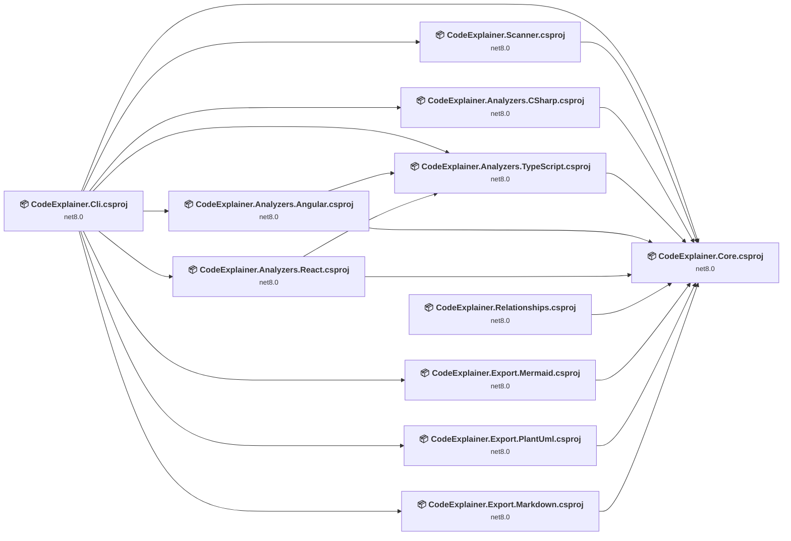

## Project Details

### src\CodeExplainer.Analyzers.Angular\CodeExplainer.Analyzers.Angular.csproj

#### Project Info

- **Current Target Framework:** net8.0
- **Proposed Target Framework:** net10.0
- **SDK-style**: True
- **Project Kind:** ClassLibrary
- **Dependencies**: 2
- **Dependants**: 1
- **Number of Files**: 1
- **Number of Files with Incidents**: 1
- **Lines of Code**: 42
- **Estimated LOC to modify**: 0+ (at least 0.0% of the project)

#### Dependency Graph

Legend:
📦 SDK-style project
⚙️ Classic project

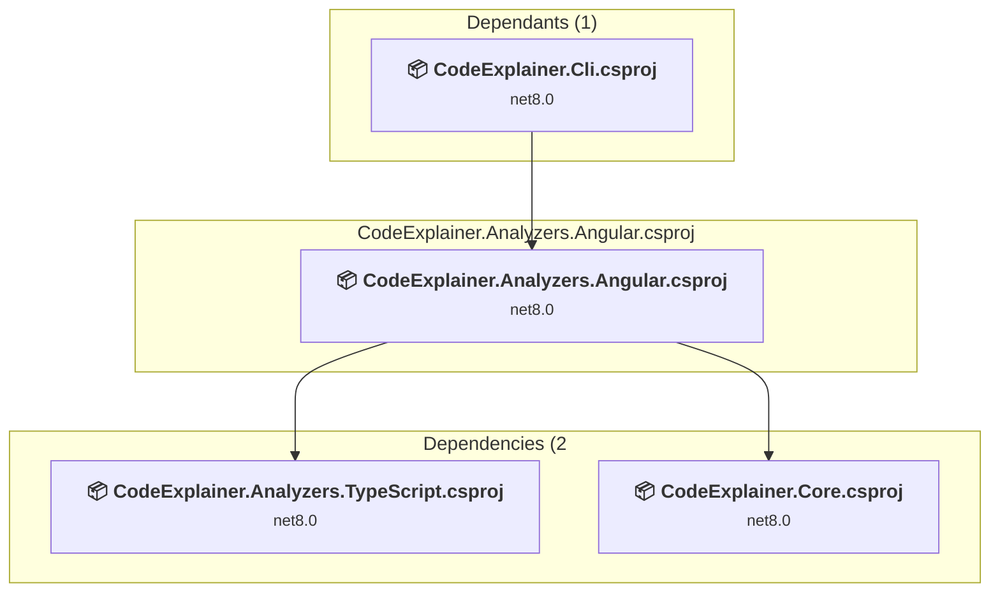

### API Compatibility

| Category | Count | Impact |
| :--- | :---: | :--- |
| 🔴 Binary Incompatible | 0 | High - Require code changes |
| 🟡 Source Incompatible | 0 | Medium - Needs re-compilation and potential conflicting API error fixing |
| 🔵 Behavioral change | 0 | Low - Behavioral changes that may require testing at runtime |
| ✅ Compatible | 14 |  |
| ***Total APIs Analyzed*** | ***14*** |  |

### src\CodeExplainer.Analyzers.CSharp\CodeExplainer.Analyzers.CSharp.csproj

#### Project Info

- **Current Target Framework:** net8.0
- **Proposed Target Framework:** net10.0
- **SDK-style**: True
- **Project Kind:** ClassLibrary
- **Dependencies**: 1
- **Dependants**: 1
- **Number of Files**: 1
- **Number of Files with Incidents**: 1
- **Lines of Code**: 66
- **Estimated LOC to modify**: 0+ (at least 0.0% of the project)

#### Dependency Graph

Legend:
📦 SDK-style project
⚙️ Classic project

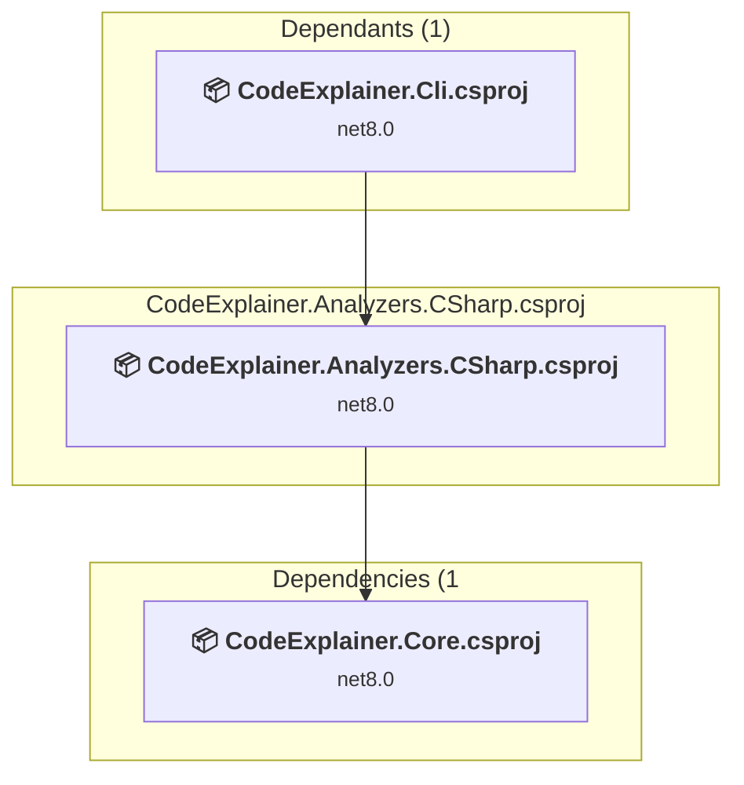

### API Compatibility

| Category | Count | Impact |
| :--- | :---: | :--- |
| 🔴 Binary Incompatible | 0 | High - Require code changes |
| 🟡 Source Incompatible | 0 | Medium - Needs re-compilation and potential conflicting API error fixing |
| 🔵 Behavioral change | 0 | Low - Behavioral changes that may require testing at runtime |
| ✅ Compatible | 150 |  |
| ***Total APIs Analyzed*** | ***150*** |  |

### src\CodeExplainer.Analyzers.React\CodeExplainer.Analyzers.React.csproj

#### Project Info

- **Current Target Framework:** net8.0
- **Proposed Target Framework:** net10.0
- **SDK-style**: True
- **Project Kind:** ClassLibrary
- **Dependencies**: 2
- **Dependants**: 1
- **Number of Files**: 1
- **Number of Files with Incidents**: 1
- **Lines of Code**: 45
- **Estimated LOC to modify**: 0+ (at least 0.0% of the project)

#### Dependency Graph

Legend:
📦 SDK-style project
⚙️ Classic project

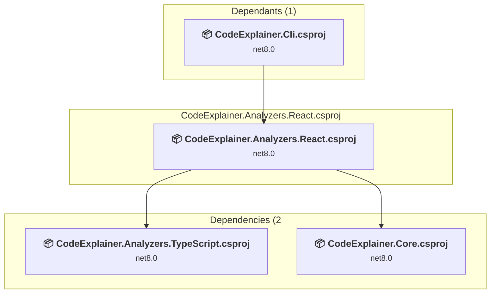

### API Compatibility

| Category | Count | Impact |
| :--- | :---: | :--- |
| 🔴 Binary Incompatible | 0 | High - Require code changes |
| 🟡 Source Incompatible | 0 | Medium - Needs re-compilation and potential conflicting API error fixing |
| 🔵 Behavioral change | 0 | Low - Behavioral changes that may require testing at runtime |
| ✅ Compatible | 14 |  |
| ***Total APIs Analyzed*** | ***14*** |  |

### src\CodeExplainer.Analyzers.TypeScript\CodeExplainer.Analyzers.TypeScript.csproj

#### Project Info

- **Current Target Framework:** net8.0
- **Proposed Target Framework:** net10.0
- **SDK-style**: True
- **Project Kind:** ClassLibrary
- **Dependencies**: 1
- **Dependants**: 3
- **Number of Files**: 1
- **Number of Files with Incidents**: 1
- **Lines of Code**: 49
- **Estimated LOC to modify**: 0+ (at least 0.0% of the project)

#### Dependency Graph

Legend:
📦 SDK-style project
⚙️ Classic project

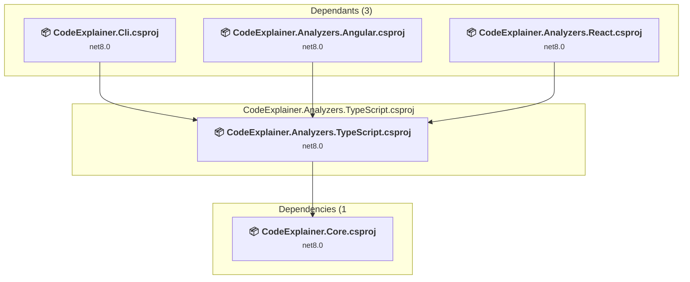

### API Compatibility

| Category | Count | Impact |
| :--- | :---: | :--- |
| 🔴 Binary Incompatible | 0 | High - Require code changes |
| 🟡 Source Incompatible | 0 | Medium - Needs re-compilation and potential conflicting API error fixing |
| 🔵 Behavioral change | 0 | Low - Behavioral changes that may require testing at runtime |
| ✅ Compatible | 30 |  |
| ***Total APIs Analyzed*** | ***30*** |  |

### src\CodeExplainer.Cli\CodeExplainer.Cli.csproj

#### Project Info

- **Current Target Framework:** net8.0
- **Proposed Target Framework:** net10.0
- **SDK-style**: True
- **Project Kind:** DotNetCoreApp
- **Dependencies**: 9
- **Dependants**: 0
- **Number of Files**: 1
- **Number of Files with Incidents**: 2
- **Lines of Code**: 71
- **Estimated LOC to modify**: 13+ (at least 18.3% of the project)

#### Dependency Graph

Legend:
📦 SDK-style project
⚙️ Classic project

```mermaid
flowchart TB
    subgraph current["CodeExplainer.Cli.csproj"]
        MAIN["<b>📦&nbsp;CodeExplainer.Cli.csproj</b><br/><small>net8.0</small>"]
        click MAIN "#srccodeexplainerclicodeexplainerclicsproj"
    end
    subgraph downstream["Dependencies (9"]
        P10["<b>📦&nbsp;CodeExplainer.Export.PlantUml.csproj</b><br/><small>net8.0</small>"]
        P11["<b>📦&nbsp;CodeExplainer.Export.Markdown.csproj</b><br/><small>net8.0</small>"]
        P4["<b>📦&nbsp;CodeExplainer.Analyzers.CSharp.csproj</b><br/><small>net8.0</small>"]
        P5["<b>📦&nbsp;CodeExplainer.Analyzers.TypeScript.csproj</b><br/><small>net8.0</small>"]
        P3["<b>📦&nbsp;CodeExplainer.Scanner.csproj</b><br/><small>net8.0</small>"]
        P2["<b>📦&nbsp;CodeExplainer.Core.csproj</b><br/><small>net8.0</small>"]
        P9["<b>📦&nbsp;CodeExplainer.Export.Mermaid.csproj</b><br/><small>net8.0</small>"]
        P6["<b>📦&nbsp;CodeExplainer.Analyzers.Angular.csproj</b><br/><small>net8.0</small>"]
        P7["<b>📦&nbsp;CodeExplainer.Analyzers.React.csproj</b><br/><small>net8.0</small>"]
        click P10 "#srccodeexplainerexportplantumlcodeexplainerexportplantumlcsproj"
        click P11 "#srccodeexplainerexportmarkdowncodeexplainerexportmarkdowncsproj"
        click P4 "#srccodeexplaineranalyzerscsharpcodeexplaineranalyzerscsharpcsproj"
        click P5 "#srccodeexplaineranalyzerstypescriptcodeexplaineranalyzerstypescriptcsproj"
        click P3 "#srccodeexplainerscannercodeexplainerscannercsproj"
        click P2 "#srccodeexplainercorecodeexplainercorecsproj"
        click P9 "#srccodeexplainerexportmermaidcodeexplainerexportmermaidcsproj"
        click P6 "#srccodeexplaineranalyzersangularcodeexplaineranalyzersangularcsproj"
        click P7 "#srccodeexplaineranalyzersreactcodeexplaineranalyzersreactcsproj"
    end
    MAIN --> P10
    MAIN --> P11
    MAIN --> P4
    MAIN --> P5
    MAIN --> P3
    MAIN --> P2
    MAIN --> P9
    MAIN --> P6
    MAIN --> P7

```

### API Compatibility

| Category | Count | Impact |
| :--- | :---: | :--- |
| 🔴 Binary Incompatible | 0 | High - Require code changes |
| 🟡 Source Incompatible | 13 | Medium - Needs re-compilation and potential conflicting API error fixing |
| 🔵 Behavioral change | 0 | Low - Behavioral changes that may require testing at runtime |
| ✅ Compatible | 74 |  |
| ***Total APIs Analyzed*** | ***87*** |  |

### src\CodeExplainer.Core\CodeExplainer.Core.csproj

#### Project Info

- **Current Target Framework:** net8.0
- **Proposed Target Framework:** net10.0
- **SDK-style**: True
- **Project Kind:** ClassLibrary
- **Dependencies**: 0
- **Dependants**: 10
- **Number of Files**: 6
- **Number of Files with Incidents**: 1
- **Lines of Code**: 394
- **Estimated LOC to modify**: 0+ (at least 0.0% of the project)

#### Dependency Graph

Legend:
📦 SDK-style project
⚙️ Classic project

```mermaid
flowchart TB
    subgraph upstream["Dependants (10)"]
        P1["<b>📦&nbsp;CodeExplainer.Cli.csproj</b><br/><small>net8.0</small>"]
        P3["<b>📦&nbsp;CodeExplainer.Scanner.csproj</b><br/><small>net8.0</small>"]
        P4["<b>📦&nbsp;CodeExplainer.Analyzers.CSharp.csproj</b><br/><small>net8.0</small>"]
        P5["<b>📦&nbsp;CodeExplainer.Analyzers.TypeScript.csproj</b><br/><small>net8.0</small>"]
        P6["<b>📦&nbsp;CodeExplainer.Analyzers.Angular.csproj</b><br/><small>net8.0</small>"]
        P7["<b>📦&nbsp;CodeExplainer.Analyzers.React.csproj</b><br/><small>net8.0</small>"]
        P8["<b>📦&nbsp;CodeExplainer.Relationships.csproj</b><br/><small>net8.0</small>"]
        P9["<b>📦&nbsp;CodeExplainer.Export.Mermaid.csproj</b><br/><small>net8.0</small>"]
        P10["<b>📦&nbsp;CodeExplainer.Export.PlantUml.csproj</b><br/><small>net8.0</small>"]
        P11["<b>📦&nbsp;CodeExplainer.Export.Markdown.csproj</b><br/><small>net8.0</small>"]
        click P1 "#srccodeexplainerclicodeexplainerclicsproj"
        click P3 "#srccodeexplainerscannercodeexplainerscannercsproj"
        click P4 "#srccodeexplaineranalyzerscsharpcodeexplaineranalyzerscsharpcsproj"
        click P5 "#srccodeexplaineranalyzerstypescriptcodeexplaineranalyzerstypescriptcsproj"
        click P6 "#srccodeexplaineranalyzersangularcodeexplaineranalyzersangularcsproj"
        click P7 "#srccodeexplaineranalyzersreactcodeexplaineranalyzersreactcsproj"
        click P8 "#srccodeexplainerrelationshipscodeexplainerrelationshipscsproj"
        click P9 "#srccodeexplainerexportmermaidcodeexplainerexportmermaidcsproj"
        click P10 "#srccodeexplainerexportplantumlcodeexplainerexportplantumlcsproj"
        click P11 "#srccodeexplainerexportmarkdowncodeexplainerexportmarkdowncsproj"
    end
    subgraph current["CodeExplainer.Core.csproj"]
        MAIN["<b>📦&nbsp;CodeExplainer.Core.csproj</b><br/><small>net8.0</small>"]
        click MAIN "#srccodeexplainercorecodeexplainercorecsproj"
    end
    P1 --> MAIN
    P3 --> MAIN
    P4 --> MAIN
    P5 --> MAIN
    P6 --> MAIN
    P7 --> MAIN
    P8 --> MAIN
    P9 --> MAIN
    P10 --> MAIN
    P11 --> MAIN

```

### API Compatibility

| Category | Count | Impact |
| :--- | :---: | :--- |
| 🔴 Binary Incompatible | 0 | High - Require code changes |
| 🟡 Source Incompatible | 0 | Medium - Needs re-compilation and potential conflicting API error fixing |
| 🔵 Behavioral change | 0 | Low - Behavioral changes that may require testing at runtime |
| ✅ Compatible | 604 |  |
| ***Total APIs Analyzed*** | ***604*** |  |

### src\CodeExplainer.Export.Markdown\CodeExplainer.Export.Markdown.csproj

#### Project Info

- **Current Target Framework:** net8.0
- **Proposed Target Framework:** net10.0
- **SDK-style**: True
- **Project Kind:** ClassLibrary
- **Dependencies**: 1
- **Dependants**: 1
- **Number of Files**: 1
- **Number of Files with Incidents**: 1
- **Lines of Code**: 31
- **Estimated LOC to modify**: 0+ (at least 0.0% of the project)

#### Dependency Graph

Legend:
📦 SDK-style project
⚙️ Classic project

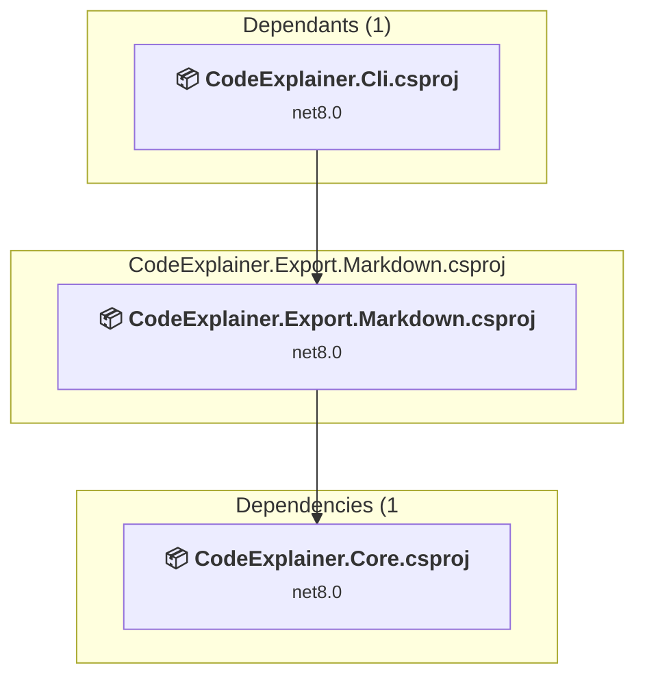

### API Compatibility

| Category | Count | Impact |
| :--- | :---: | :--- |
| 🔴 Binary Incompatible | 0 | High - Require code changes |
| 🟡 Source Incompatible | 0 | Medium - Needs re-compilation and potential conflicting API error fixing |
| 🔵 Behavioral change | 0 | Low - Behavioral changes that may require testing at runtime |
| ✅ Compatible | 7 |  |
| ***Total APIs Analyzed*** | ***7*** |  |

### src\CodeExplainer.Export.Mermaid\CodeExplainer.Export.Mermaid.csproj

#### Project Info

- **Current Target Framework:** net8.0
- **Proposed Target Framework:** net10.0
- **SDK-style**: True
- **Project Kind:** ClassLibrary
- **Dependencies**: 1
- **Dependants**: 1
- **Number of Files**: 1
- **Number of Files with Incidents**: 1
- **Lines of Code**: 37
- **Estimated LOC to modify**: 0+ (at least 0.0% of the project)

#### Dependency Graph

Legend:
📦 SDK-style project
⚙️ Classic project

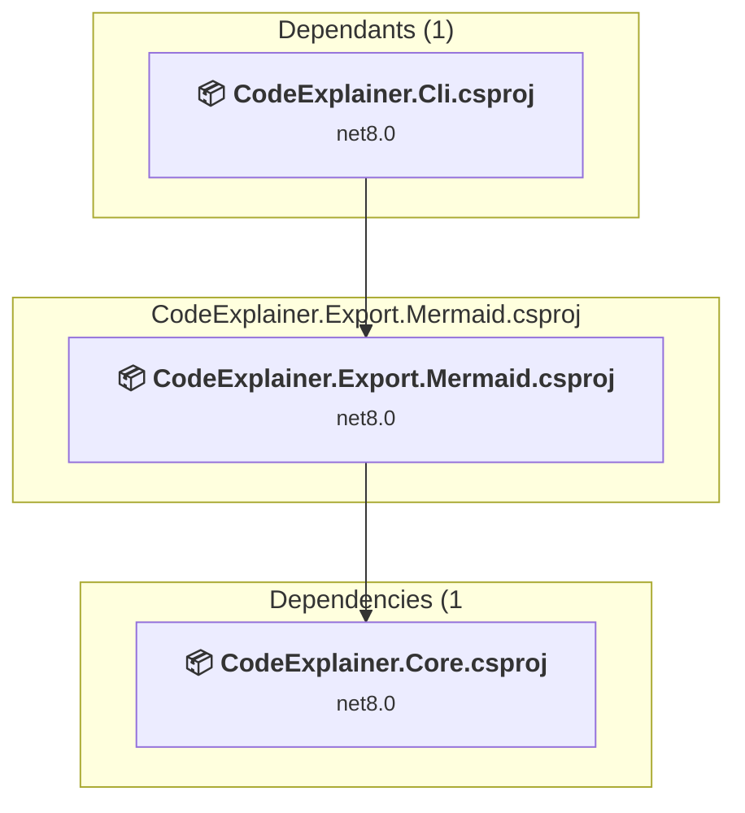

### API Compatibility

| Category | Count | Impact |
| :--- | :---: | :--- |
| 🔴 Binary Incompatible | 0 | High - Require code changes |
| 🟡 Source Incompatible | 0 | Medium - Needs re-compilation and potential conflicting API error fixing |
| 🔵 Behavioral change | 0 | Low - Behavioral changes that may require testing at runtime |
| ✅ Compatible | 137 |  |
| ***Total APIs Analyzed*** | ***137*** |  |

### src\CodeExplainer.Export.PlantUml\CodeExplainer.Export.PlantUml.csproj

#### Project Info

- **Current Target Framework:** net8.0
- **Proposed Target Framework:** net10.0
- **SDK-style**: True
- **Project Kind:** ClassLibrary
- **Dependencies**: 1
- **Dependants**: 1
- **Number of Files**: 1
- **Number of Files with Incidents**: 1
- **Lines of Code**: 48
- **Estimated LOC to modify**: 0+ (at least 0.0% of the project)

#### Dependency Graph

Legend:
📦 SDK-style project
⚙️ Classic project

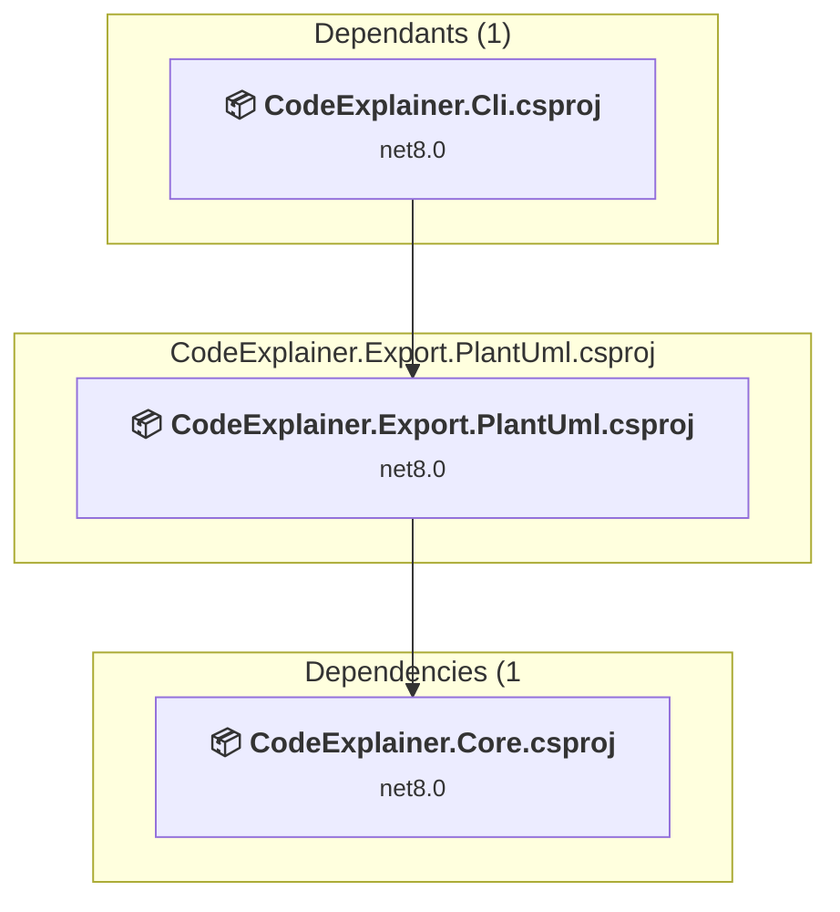

### API Compatibility

| Category | Count | Impact |
| :--- | :---: | :--- |
| 🔴 Binary Incompatible | 0 | High - Require code changes |
| 🟡 Source Incompatible | 0 | Medium - Needs re-compilation and potential conflicting API error fixing |
| 🔵 Behavioral change | 0 | Low - Behavioral changes that may require testing at runtime |
| ✅ Compatible | 22 |  |
| ***Total APIs Analyzed*** | ***22*** |  |

### src\CodeExplainer.Relationships\CodeExplainer.Relationships.csproj

#### Project Info

- **Current Target Framework:** net8.0
- **Proposed Target Framework:** net10.0
- **SDK-style**: True
- **Project Kind:** ClassLibrary
- **Dependencies**: 1
- **Dependants**: 0
- **Number of Files**: 1
- **Number of Files with Incidents**: 1
- **Lines of Code**: 32
- **Estimated LOC to modify**: 0+ (at least 0.0% of the project)

#### Dependency Graph

Legend:
📦 SDK-style project
⚙️ Classic project

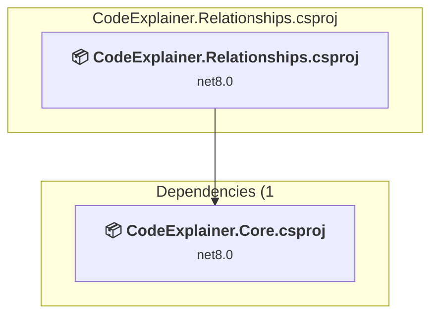

### API Compatibility

| Category | Count | Impact |
| :--- | :---: | :--- |
| 🔴 Binary Incompatible | 0 | High - Require code changes |
| 🟡 Source Incompatible | 0 | Medium - Needs re-compilation and potential conflicting API error fixing |
| 🔵 Behavioral change | 0 | Low - Behavioral changes that may require testing at runtime |
| ✅ Compatible | 8 |  |
| ***Total APIs Analyzed*** | ***8*** |  |

### src\CodeExplainer.Scanner\CodeExplainer.Scanner.csproj

#### Project Info

- **Current Target Framework:** net8.0
- **Proposed Target Framework:** net10.0
- **SDK-style**: True
- **Project Kind:** ClassLibrary
- **Dependencies**: 1
- **Dependants**: 1
- **Number of Files**: 1
- **Number of Files with Incidents**: 1
- **Lines of Code**: 82
- **Estimated LOC to modify**: 0+ (at least 0.0% of the project)

#### Dependency Graph

Legend:
📦 SDK-style project
⚙️ Classic project

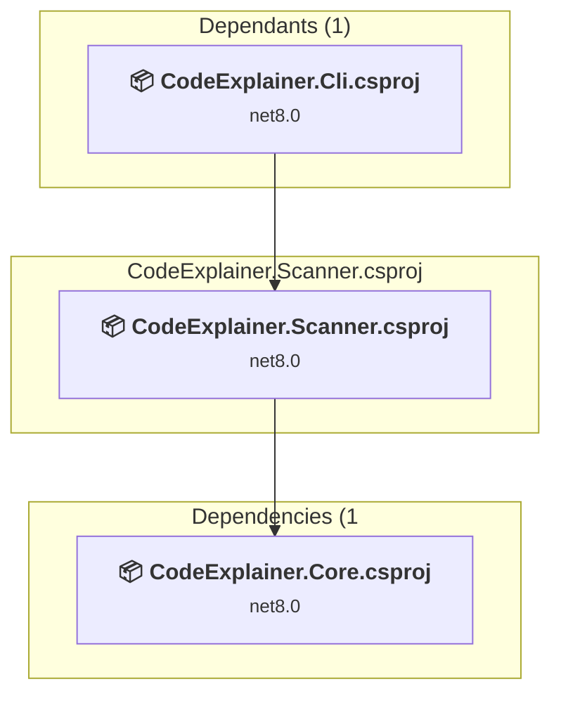

### API Compatibility

| Category | Count | Impact |
| :--- | :---: | :--- |
| 🔴 Binary Incompatible | 0 | High - Require code changes |
| 🟡 Source Incompatible | 0 | Medium - Needs re-compilation and potential conflicting API error fixing |
| 🔵 Behavioral change | 0 | Low - Behavioral changes that may require testing at runtime |
| ✅ Compatible | 54 |  |
| ***Total APIs Analyzed*** | ***54*** |  |

