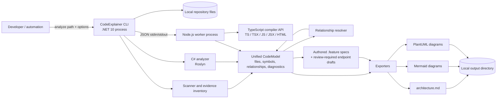
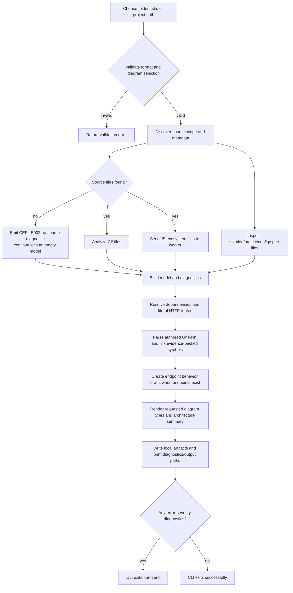

# CodeExplainer — High-Level Design

## Scope and evidence

This describes the repository's implemented analyzer and its local execution boundary, based on `src/CodeExplainer.Cli/Program.cs`, `AnalysisPipeline.cs`, `CodeExplainer.Cli.csproj`, the analyzer/scanner/exporter projects, `workers/typescript-analyzer/package.json`, and `Directory.Packages.props`. It is not a design for a deployed product: the repository contains a command-line process, local file scanning, and a Node.js worker subprocess. No hosted API, interactive UI, database, cache, message broker, cloud deployment, or independent background-job service was found. A scanned target may contain such infrastructure; those are input evidence rather than CodeExplainer runtime dependencies.

## System context and runtime topology

**Boundary notes:** the CLI invokes the Node worker as a child process and exchanges one JSON request/response over redirected standard input/output. The worker defaults to `node`; `CODEEXPLAINER_NODE_PATH` may select another executable. The worker is located by `--worker`, `CODEEXPLAINER_TYPESCRIPT_WORKER`, or the bundled workspace-relative `workers/typescript-analyzer/dist/index.js` lookup. Its default timeout is 30 seconds. Ctrl+C cancels the pipeline; cancellation is propagated to the worker and kills its process tree when needed.

## End-to-end user workflows

Discovery recognizes `.cs`, `.ts`, `.tsx`, `.js`, `.jsx`, and `.html`; default ignored directories include `node_modules`, `bin`, `obj`, `dist`, `build`, `.git`, and common IDE/build outputs. Test files are excluded unless explicitly enabled. Folder, solution, and project inputs are resolved by `FileScanner`; project context includes solution/project paths, TypeScript configs, configuration files, and `.feature` files. Unreadable C# sources produce a warning; unavailable/failed worker execution produces an error diagnostic; empty source scopes produce a warning and still generate an analysis result. Unsupported format or diagram names are rejected before scanning.

## Capabilities and documented behavior

- CLI selects `mermaid` or `plantuml` and one or more of `architecture`, `modules`, `behavior`, `dependency`, `class`, `component`, and `sequence`.
- C# analysis uses Roslyn syntax parsing for declarations, dependencies, controllers/routes, minimal APIs, and hosted-worker role evidence. It does not run the target application.
- The TypeScript worker uses the TypeScript compiler API and supports TypeScript/JavaScript syntax plus Angular/React-oriented analysis; discovered literals/imports/relationships are static evidence, not proof of runtime execution.
- Repository evidence inventories project/package/configuration and infrastructure declarations. Configuration values are not intended to be copied into generated summaries. Confidence is explicitly distinguished (`Observed` or `Inferred`) where applicable.
- Authored Gherkin features are parsed as behavior documentation; symbol linking is heuristic and evidence-based, and cannot establish business completeness. API-endpoint scenarios generated from code are tagged `@draft` and `@review_required`; they are prompts for review, not authoritative requirements.
- Implemented BDD specifications: [`code-explainer-cli.feature`](../behavior/code-explainer-cli.feature) exercises CLI/pipeline behaviors with Reqnroll + xUnit; [`typescript-analysis.feature`](../../workers/typescript-analyzer/features/typescript-analysis.feature) exercises worker protocol scenarios with Cucumber.js.

## Evidence-backed technology and configuration inventory

| Concern | Evidence in repository | What the evidence supports |
|---|---|---|
| Runtime and CLI | `src/CodeExplainer.Cli/CodeExplainer.Cli.csproj` (`net10.0`); `Program.cs` (`System.CommandLine`) | Local .NET 10 command-line executable; not a hosted service. |
| C# parsing | `CodeExplainer.Analyzers.CSharp.csproj` (`Microsoft.CodeAnalysis.CSharp.Workspaces` 4.8.0) | Roslyn-powered static parsing. |
| JS ecosystem worker | `workers/typescript-analyzer/package.json` (TypeScript `^5.3.0`); `tsconfig.json` (ES2021, CommonJS, strict) | Local Node worker using TypeScript compiler APIs. |
| Export | `CodeExplainer.Export.Mermaid`, `CodeExplainer.Export.PlantUml`, `CodeExplainer.Export.Markdown` | Local text artifact generation. |
| BDD tooling | `Directory.Packages.props` (Reqnroll.xUnit 2.4.1, xUnit 2.9.3); worker `package.json` (`@cucumber/cucumber` `^11.3.0`) | OSS BDD runners are used for executable behavior specifications. |
| Target-repository evidence | `RepositoryEvidenceScanner.cs` | Recognizes selected project/package/framework, appsettings keys, Terraform/Bicep resources, container manifests, and CI workflow evidence. Detection is limited to implemented patterns and supplied files. |

The analyzer may report detected Redis, message brokers, databases, storage, Azure resources, containers, Docker, or CI/CD when corresponding input evidence is found. Their mention in the scanner's capability is **not** evidence that CodeExplainer itself uses or deploys those services.
