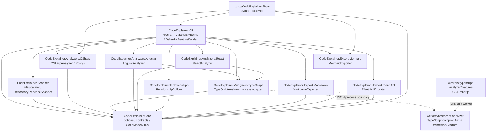
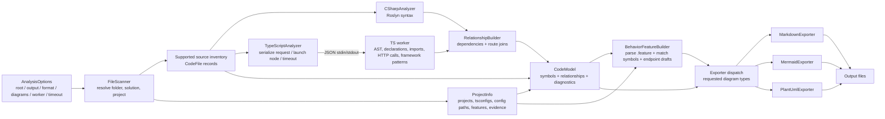
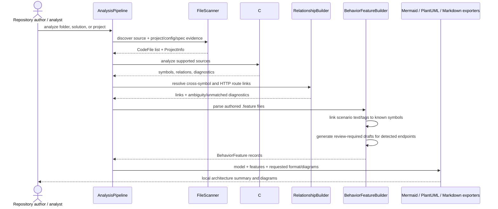

# CodeExplainer — Project and Module Low-Level Design

## 1. Solution/project dependency view

Project references below describe compile-time dependencies. Runtime flow is more specific: the CLI instantiates the scanner, C# analyzer, TypeScript worker adapter, relationship resolver, and exporters in `AnalysisPipeline`; Angular/React analyzer projects are framework-analysis libraries referenced by the CLI and TypeScript analyzer project.

## 2. Pipeline modules and data flow

### Module responsibilities and observed failure behavior

| Module | Responsibility | Evidence-backed behavior |
|---|---|---|
| `Program` | Parse CLI options and coordinate cancellation/exit codes | Default format Mermaid; default diagrams include all seven supported kinds; Ctrl+C cancels; error diagnostics produce exit code 1. |
| `FileScanner` | Resolve input scope, filter sources, collect project/config/spec inventory | Folder, `.sln`, or project; default ignore list; optional test-file inclusion; stable relative paths. |
| `RepositoryEvidenceScanner` | Infer technology/resource inventory from recognized metadata and manifests | Evidence records name/category/source/evidence type/confidence; scans known package/project files, selected config keys, Terraform/Bicep, containers and workflow files. |
| `CSharpAnalyzer` | Extract C# symbols, controller/minimal API endpoints, constructor dependency metadata, worker role metadata | Uses Roslyn syntax trees; no target execution or semantic build is performed by this pipeline path. |
| `TypeScriptAnalyzer` + Node worker | Exchange request/response and analyze TS/JS/HTML | Node process receives root-relative file paths; worker rejects paths outside root, can report parse/static-analysis diagnostics, and has timeout/error handling. |
| `RelationshipBuilder` | Link dependency metadata and matching literal HTTP request/endpoint pairs | Ambiguous/unmatched route/dependency evidence produces diagnostics rather than an assumed link. |
| `BehaviorFeatureBuilder` | Parse feature/scenario/steps/tags, relate route/action/name evidence, create endpoint drafts | Authored scenarios remain non-drafts; inferred endpoint scenarios carry review-required tags; route-related endpoint links now include the owning controller when available. |
| Exporters | Render text artifacts | Markdown summary plus selected Mermaid/PlantUML diagrams; output paths are constrained to the output directory for generated Gherkin drafts. |

## 3. Behavior scenarios and implementation traceability

The behavior diagram is a traceability view, not an execution diagram. It displays authored scenario steps and any implementation symbols linked by explicit `@code_...` tags or normalized textual matches against symbol names, routes, and actions. For C# controller endpoints, endpoint metadata records `controllerId`; a route-linked scenario includes both the endpoint and its controller. Endpoint drafts are emitted to `behavior/drafts/api-endpoints.feature` when endpoint symbols are detected.

## 4. Executable BDD coverage

| BDD feature | OSS runner | Behaviors covered in current feature | Step implementation |
|---|---|---|---|
| `docs/behavior/code-explainer-cli.feature` | Reqnroll.xUnit + xUnit | solution/project context; mixed C#/TypeScript discovery; empty scope; invalid format; configuration secrecy and infrastructure evidence; endpoint draft review tags | `tests/CodeExplainer.Tests/CodeExplainerBddSteps.cs` |
| `workers/typescript-analyzer/features/typescript-analysis.feature` | Cucumber.js (`@cucumber/cucumber`) | module/declaration extraction; literal HTTP call relationship; unresolved dynamic route warning; analysis-root path rejection | `workers/typescript-analyzer/src/gherkin-steps.ts` |

These scenarios are representative, executable contracts for the currently discovered and implemented behaviors, not a claim of exhaustive business coverage. Inferred requirements and links require human review; static analysis cannot prove behavior for dynamic dispatch, runtime configuration, external systems, or unrepresented source paths.

## 5. Configuration, technologies, and operational facts

- **.NET:** projects target `net10.0`; central NuGet versions are managed in `Directory.Packages.props`. CLI argument parsing uses `System.CommandLine` 2.0.0. C# analysis references `Microsoft.CodeAnalysis.CSharp.Workspaces` 4.8.0 and `Microsoft.Build.Locator` 1.11.2.
- **TypeScript worker:** `workers/typescript-analyzer/package.json` declares TypeScript `^5.3.0`; TypeScript compiler options select ES2021/CommonJS and strict mode. Cucumber.js is a development dependency and `npm run test:bdd` builds before executing feature files.
- **BDD .NET runner:** `Reqnroll.xUnit` 2.4.1 and xUnit 2.9.3 are centrally versioned. The CLI feature is linked as a `ReqnrollFeature` into the test project.
- **Worker selection:** explicit CLI `--worker`; `CODEEXPLAINER_TYPESCRIPT_WORKER`; or workspace-relative built worker discovery. `CODEEXPLAINER_NODE_PATH` can override `node`. Worker timeout is 30,000 ms by default in `AnalysisOptions`.
- **Output:** default directory `./generated`; generated endpoint feature drafts are written under `behavior/drafts`; output diagram extensions are `.mmd` or `.puml`; summary is `architecture.md`.
- **Not evidenced as runtime services:** no persistent database, hosted web endpoint, authentication/authorization service, broker, cache, cloud account, deployment target, or scheduler is part of the analyzer process. The scanner can report evidence for some of these in arbitrary analyzed repositories, but configuration-key matches are inferences, not proof of a live service.
